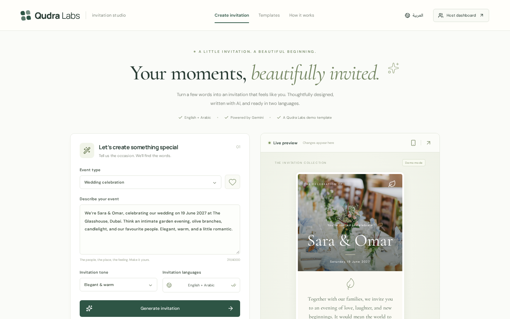
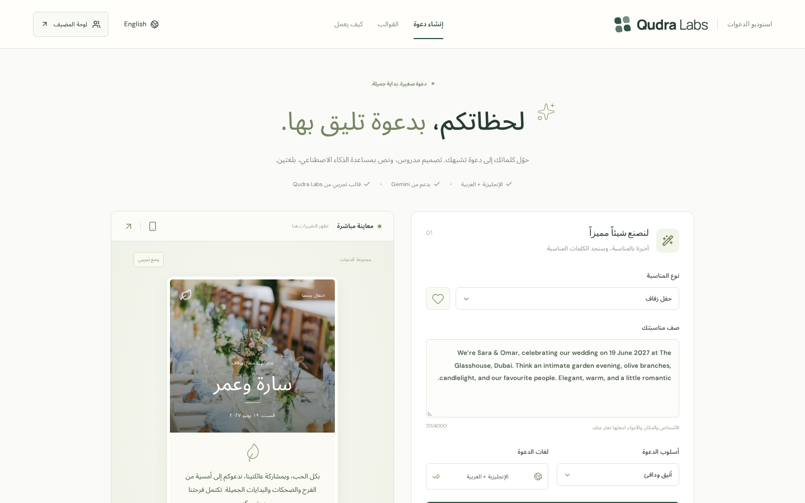
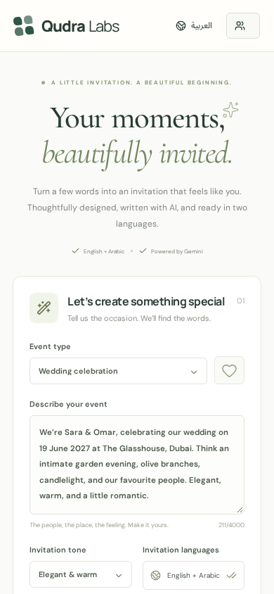

# Qudra Invitations: AI Digital Invitation Generator

Describe your event and Gemini writes bilingual (EN/AR) invite copy and a theme. Includes RSVP and AI-summarised guest notes.

A demo template by **Qudra Labs**. Bilingual English / Arabic (RTL), with AI from Google Gemini (`gemini-2.5-flash`) called server-side only.

| English | Arabic (RTL) | Mobile |
|---|---|---|
|  |  |  |

## Run locally
```bash
npm install
cp .env.example .env.local   # add GEMINI_API_KEY from https://aistudio.google.com/apikey
npm run dev
```
With no `GEMINI_API_KEY` set, the app runs in **Demo mode** with canned AI replies (the screenshots were taken in Demo mode). The business and people shown are fictional.

## Credits
Built from [heejin-hwang/mobile-wedding-invitation](https://github.com/heejin-hwang/mobile-wedding-invitation) (MIT license). The original LICENSE is kept in this repo, and the original README is in `docs/TEMPLATE-README.md`.
